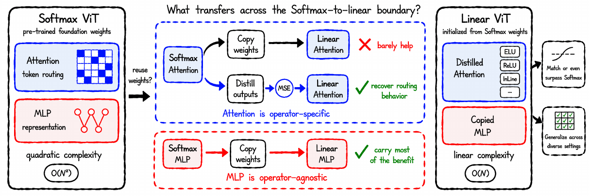

<div align="center">

# Copy the Same, Distill the Difference: Initializing Linear Vision Transformers

### arXiv 2026

<p>
Huaiyuan Qin<sup>1</sup>&nbsp;&nbsp;&nbsp;&nbsp; Muli Yang<sup>1</sup>&nbsp;&nbsp;&nbsp;&nbsp; Gabriel James Goenawan<sup>1</sup>&nbsp;&nbsp;&nbsp;&nbsp; Shiqi Huang<sup>2</sup><br>
Min Kass Chong<sup>3</sup>&nbsp;&nbsp;&nbsp;&nbsp; Wahyu Wiratama<sup>3</sup>&nbsp;&nbsp;&nbsp;&nbsp; Peng Hu<sup>4</sup>&nbsp;&nbsp;&nbsp;&nbsp; Chen Gong<sup>5</sup><br>
Wu Liu<sup>6</sup>&nbsp;&nbsp;&nbsp;&nbsp; Xi Peng<sup>4</sup>&nbsp;&nbsp;&nbsp;&nbsp; Chun Jian Ho<sup>3</sup>&nbsp;&nbsp;&nbsp;&nbsp; Hongyuan Zhu<sup>1</sup>
</p>

<p>
<sup>1</sup>Institute of Advanced Intelligence and Computing (IAIC), A*STAR, Singapore&nbsp;&nbsp;&nbsp;&nbsp; <sup>2</sup>Nanyang Technological University<br>
<sup>3</sup>ST Engineering Geo-Insights, Singapore&nbsp;&nbsp;&nbsp;&nbsp; <sup>4</sup>Sichuan University<br>
<sup>5</sup>Shanghai Jiao Tong University&nbsp;&nbsp;&nbsp;&nbsp; <sup>6</sup>University of Science and Technology of China
</p>

[](https://arxiv.org/abs/2609.35745)
[](https://arxiv.org/pdf/2609.35745)
[](https://leonqin430.github.io/projects/copy-the-same-distill-the-difference/)
[](LICENSE)



**Softmax attention weights are *operator-specific*, MLP weights are *operator-agnostic*: copy what stays the same and distill what differs.**

</div>

Linear Vision Transformers (ViTs) replace the Softmax attention of a standard ViT with a linear-complexity
operator, but they are usually pre-trained from scratch. We ask whether they can instead be initialized from
the pre-trained weights of a Softmax ViT, and find that the answer depends on the component. The attention
weights are *operator-specific*: copying them into a linear operator barely helps and can fall below random
initialization, across five operators (ELU, ReLU, InLine, MHLA, TTT), three model sizes and seven datasets.
The attention's token routing behavior is instead recovered by distilling the attention *outputs* of a frozen
Softmax teacher. The MLP weights are *operator-agnostic*: copying them already carries most of the benefit of
the pre-trained weights, and paired with the distilled attention, linear ViTs match and even surpass their
Softmax counterparts.

This repository is a minimal fork of [timm](https://github.com/huggingface/pytorch-image-models) 0.9.16 as
modified by [Structured Initialization](https://github.com/osiriszjq/structured_init) (Zheng et al.). It
contains the training code for

* the five **linear ViTs** of the paper (ELU, ReLU, InLine, MHLA, TTT) and the Softmax ViT,
* the **weight-initialization settings** Random, Mimetic, Impulse, Copy, MLPCopy and FullCopy, and
* **attention distillation** from a frozen Softmax teacher (MSE on attention outputs; the map-based losses of the
  loss ablation are included).

## Installation

```bash
conda env create -f environment.yml
conda activate s2l
```

Tested with Python 3.12, PyTorch 2.9 and timm 0.9.16. The model code lives in `s2l/` and registers the ViT
entrypoints `vit_{tiny,small,base}_patch16_224` with timm when imported, so `train.py` (timm's training script)
builds them through `create_model`.

## Data

The transfer datasets are the torchvision ones and are downloaded on first use (`--dataset-download`):

| `--dataset` | `--num-classes` | epochs / warm-up |
|---|---|---|
| `torch/cifar10`, `torch/cifar100`, `torch/stl10`, `torch/food101` | 10, 100, 10, 101 | 300 / 50 |
| `torch/flowers102`, `torch/pets` | 102, 37 | 600 / 100 |

ImageNet-1K is read from the standard `ImageFolder` layout (`--dataset imagenet`):

```
/path/to/imagenet/train/<class>/*.JPEG
/path/to/imagenet/val/<class>/*.JPEG
```

## Softmax teachers

The transfer source is the DeiT checkpoint of the same model size, used both for weight copying
(`copy_ckpt_path`) and as the frozen distillation teacher (`--distill-teacher`):

| size | checkpoint |
|---|---|
| Tiny | [deit_tiny_patch16_224](https://dl.fbaipublicfiles.com/deit/deit_tiny_patch16_224-a1311bcf.pth) |
| Small | [deit_small_patch16_224](https://dl.fbaipublicfiles.com/deit/deit_small_patch16_224-cd65a155.pth) |
| Base | [deit_base_patch16_224](https://dl.fbaipublicfiles.com/deit/deit_base_patch16_224-b5f2ef4d.pth) |

Any checkpoint whose state dict (or whose `model` entry) uses the DeiT key names works (`cls_token`, `pos_embed`,
`patch_embed.proj.*`, `blocks.{i}.attn.qkv.*`, `blocks.{i}.attn.proj.*`, `blocks.{i}.mlp.fc{1,2}.*`, `norm*.*`).
Copying is shape-aware: parameters that do not exist in the student or have a different shape (the classifier
head, the extra rows of MHLA and TTT) are left at their own initialization.

## Models and settings

Every run is a `train.py` call with `--model vit_{tiny,small,base}_patch16_224` and the paper's setting chosen
through `--model-kwargs`:

| `attn_type` | operator |
|---|---|
| `softmax` | Softmax ViT (DeiT) |
| `elu1` | ELU: kernel ELU(·)+1 |
| `relu` | ReLU: kernel ReLU(·) |
| `inline` | InLine: identity kernel with subtraction normalization |
| `mhla` | MHLA: token-level multi-head linear attention with auxiliary convolutions |
| `ttt` | TTT: ViT³ block with a learned inner model instead of the attention map |

| `weight_init` | setting | what is loaded from `copy_ckpt_path` |
|---|---|---|
| `skip` | Random | nothing |
| `mimetic0.7_0.7` | Mimetic | nothing (analytical attention initialization) |
| `impulse3` | Impulse | nothing (analytical attention initialization) |
| `copy` | Copy | attention projections (`qkv`, `proj`) of every block |
| `ffncopy` | MLPCopy | MLP blocks of every block |
| `fullcopy` | FullCopy | every parameter with a matching name and shape |

Two token layouts are used, as in the paper. The attention-only settings and MLPCopy use the layout of
Structured Initialization that Mimetic and Impulse require: no class token, a fixed 2-D sin-cos position
embedding and average pooling (`class_token=False no_embed_class=True sin_pe=True` with `--gp avg`).
FullCopy and the Softmax baseline use the DeiT layout (`class_token=True no_embed_class=False sin_pe=False`
with `--gp token`). MHLA and TTT operate on the square patch grid and therefore always use the class-token-free
layout. The scripts below set the layout for you.

Distillation is switched on with `--distill-teacher <checkpoint>`: the student is paired with the frozen
Softmax teacher, and a per-block MSE between the two attention outputs, weighted by `--distill-lambda`
(50 in the paper), is added to the cross-entropy loss. `--distill-loss mse_out` is the paper's loss;
`mse_map` and `ce_map` match the attention maps instead (loss ablation, Sec. 5.4) and are only defined for
operators that materialize a map (ELU, ReLU; InLine for `mse_map`).

## Training

All transfer-dataset commands use 4 GPUs with 128 images each (total batch 512) and the recipe of the paper:
AdamW, learning rate 2e-3 with cosine decay to 1e-6, weight decay 0.05, gradient clipping 3.0,
300 epochs with 50 warm-up epochs (600 / 100 for Flowers-102 and Pets), 224x224 input, 3 seeds.
Every script takes its settings from environment variables; the defaults are ReLU, ViT-Small, CIFAR-100 and
`./checkpoints/deit_small_patch16_224.pth`.

**Attention-only initializations** (`scripts/attention_only.sh`, Sec. 4): `INIT` = `skip` | `mimetic0.7_0.7` | `impulse3` | `copy`

```bash
DATA_DIR=/path/to/data TEACHER=/path/to/deit_small_patch16_224.pth OP=relu INIT=copy bash scripts/attention_only.sh
```

**Copying components** (`scripts/copy_components.sh`, Sec. 5.2): `INIT` = `ffncopy` (MLPCopy) | `fullcopy` (FullCopy)

```bash
DATA_DIR=/path/to/data TEACHER=/path/to/deit_small_patch16_224.pth OP=relu INIT=ffncopy bash scripts/copy_components.sh
```

**Attention distillation** (`scripts/distill.sh`, Sec. 5.1 and 5.3): any `INIT` with the frozen teacher; `LAMBDA` (default 50) and `LOSS` (default `mse_out`)

```bash
DATA_DIR=/path/to/data TEACHER=/path/to/deit_small_patch16_224.pth OP=relu INIT=ffncopy bash scripts/distill.sh
```

`INIT=copy` is *Copy w/ Distill*, `INIT=ffncopy` is *MLPCopy w/ Distill* (the recipe of the paper) and
`INIT=fullcopy` is *FullCopy w/ Distill*.

**Softmax recovery target** (`scripts/softmax_baseline.sh`): the DeiT checkpoint fine-tuned on the task with the same recipe

```bash
DATA_DIR=/path/to/data TEACHER=/path/to/deit_small_patch16_224.pth bash scripts/softmax_baseline.sh
```

**ImageNet-1K** (`scripts/imagenet.sh`, Sec. 4.3 and Appendix C.3): 300 epochs, 50 warm-up epochs, total batch 4096
through gradient accumulation (`BS`/`ACCUM` = 512/2 for Tiny, 256/4 for Small, 64/16 for Base on 4 GPUs);
set `LAMBDA` to add distillation

```bash
DATA_DIR=/path/to/imagenet TEACHER=/path/to/deit_base_patch16_224.pth MODEL=vit_base_patch16_224 OP=ttt INIT=ffncopy BS=64 ACCUM=16 bash scripts/imagenet.sh
```

Other datasets, model sizes and operators follow by changing `DATASET`/`NUM_CLASSES`/`EPOCHS`/`WARMUP`,
`MODEL` and `OP`. Each run writes its checkpoint and a `summary.csv` with the per-epoch top-1 accuracy under
`OUTPUT/<experiment>/`.

## Citation

```bibtex
@article{qin2026copy,
  title   = {Copy the Same, Distill the Difference: Initializing Linear Vision Transformers},
  author  = {Qin, Huaiyuan and Yang, Muli and Goenawan, Gabriel James and Huang, Shiqi and Chong, Min Kass and
             Wiratama, Wahyu and Hu, Peng and Gong, Chen and Liu, Wu and Peng, Xi and Ho, Chun Jian and Zhu, Hongyuan},
  journal = {arXiv preprint arXiv:2609.35745},
  year    = {2026}
}
```

## Acknowledgements and license

This code is built on [timm](https://github.com/huggingface/pytorch-image-models) (Ross Wightman) and on the
[Structured Initialization](https://github.com/osiriszjq/structured_init) code of Zheng et al., which provides
the Mimetic and Impulse initializations. The linear attention operators follow their papers:
[linear attention](https://arxiv.org/abs/2006.16236) (ELU, ReLU), [InLine](https://arxiv.org/abs/2412.06590),
[MHLA](https://arxiv.org/abs/2601.07832) and [ViT³](https://arxiv.org/abs/2512.01643) (TTT).

This project is released under the Apache License 2.0, the license of timm; the Structured Initialization code
is under the MIT License. See [LICENSE](LICENSE) and [NOTICE](NOTICE) for details.
